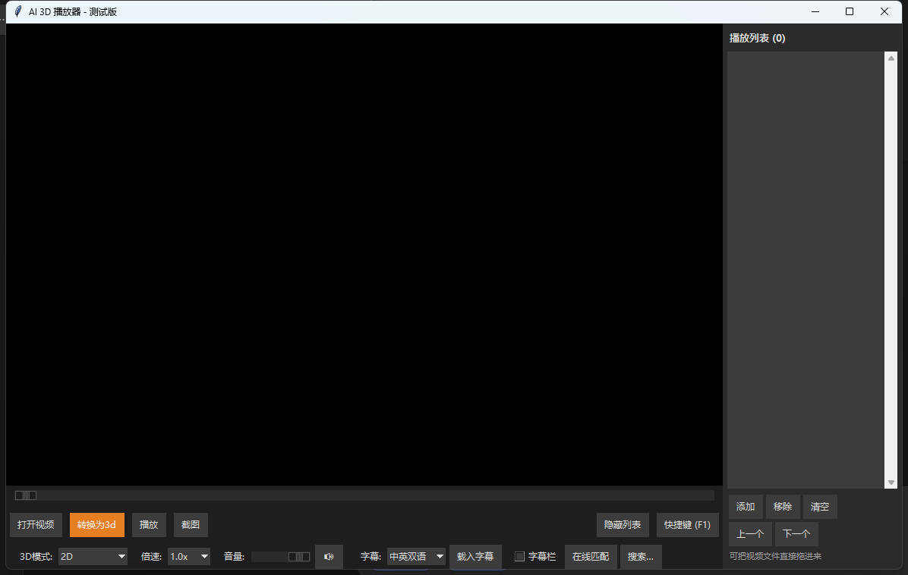
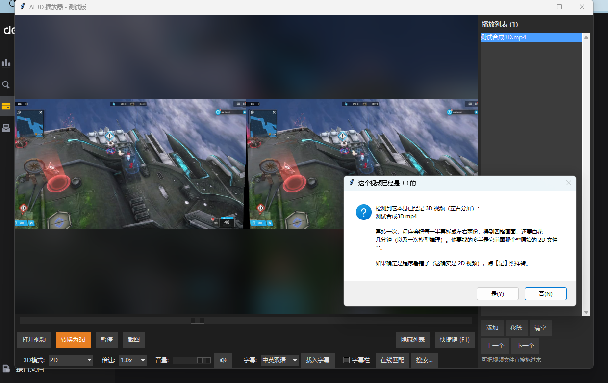

# AI 3D 视频播放器

用 AI 深度估计把普通 2D 视频**实时**转成 3D 来播放的桌面播放器。

> 仓库地址：https://github.com/Kinen4062/my-project-video



---

## 它是什么

一个 Windows 桌面视频播放器。核心只有一件事：拿深度估计模型（Depth-Anything-V2）给每一帧算出深度图，再按视差把画面重新采样出左右眼，实时合成 3D 呈现出来 —— 所以你**不需要事先转换**，打开任何一个普通 2D 视频就能看 3D。

它同时也能反过来用：把当前视频**离线转换**成一个左右分屏（SBS）的 3D 视频文件，拿去喂 VR 播放器或者别的设备。

项目从最简单的命令行播放器起步，一路迭代到现在的完整 GUI 应用。**每一轮的改动都留了一份过程记录**（写在 `docs/` 里，含当时踩的坑、被推翻的判断、实测数字），这也是为什么仓库里文档比代码还多。

---

## 功能

### 播放

- 打开本地视频播放，基于 OpenCV 逐帧读取
- 播放 / 暂停（按钮、空格或 K）
- 进度条拖动跳转，点击进度条任意位置跳转
- 倍速 0.5x / 1.0x / 1.5x / 2.0x —— **音频同步变速**（走 ffmpeg `atempo` 滤镜，不是只改画面）
- 逐帧步进（← / →），暂停后可以一帧一帧地看
- 窗口标题实时显示「当前秒数 / 总秒数」
- 打开新文件时自动记住上一个看到哪儿（见「记忆播放位置」）

### 音频

- ffpyplayer 解码并播放视频原声
- 音量滑块 + 静音开关，方向键 ↑/↓ 也能调（每次 5%）
- 暂停 / 继续、跳转、倍速都会让音频跟着走
- **没有音轨的文件从一开始就不建音频播放器**（见下方「核心实现」里的说明）

### AI 2D → 3D 转换

- 模型 `Depth-Anything-V2-Small-hf`，自动选择 CUDA / CPU
- 逐帧算深度 → 归一化后乘最大视差（`max_disparity = 20`）→ `cv2.remap` 采样出左右眼 → 拼接为左右分屏写入
- 后台线程转换，不阻塞界面；显示「已处理帧数 / 总帧数、百分比、预计剩余时间」
- 可以取消，自动清理写了一半的临时文件
- 转换收尾会用 ffmpeg 把源视频的**音轨补进产物**（`cv2.VideoWriter` 只写画面）
- 转完依次问两件事：**要另存下来吗** → **要切到红蓝 3D 吗**（不替你假设你有没有眼镜）



- **已经是 3D 的视频会被拦一下**：判据是像素而不是文件名（`XXX.3D.1080p` 里的 "3D" 常常只是发布标签）。再转一次只会得到四格画面，所以默认劝退，但留了「仍然转换」的出口

### 3D 显示

- 五种显示模式：

  | 模式 | 说明 | 需要什么 |
  |---|---|---|
  | 2D | 原始画面（左右分屏并排显示） | 不用眼镜 |
  | 红蓝 3D | Anaglyph | 红蓝眼镜 |
  | 偏振-隔行 | 奇数行左眼、偶数行右眼 | 配套显示设备 |
  | 偏振-隔列 | 奇数列左眼、偶数列右眼 | 配套显示设备 |
  | 偏振-棋盘 | 棋盘格交错分配 | 配套显示设备 |

- **实时视差调节**：滑块 -15 ~ +15，播放中或暂停时都即时生效
- **交换左右眼**：一键切换，应对眼镜戴反或片源本身左右反了
- 切换模式后立即重绘当前帧，不用重新转换

### 字幕


- 把 `.srt` / `.vtt` 放在视频旁边、与视频同名即可**自动加载**
- 认这些写法：`电影.srt`、`电影.zh.srt`、`电影.en.srt`、`电影.中英.srt`；也认视频同目录下的 `subs/`、`字幕/` 子目录；文件名看不出语种就按内容判断
- 同一时间轴上中文一行、英文一行的（字幕组最常见的那种），选【中英双语】就是中文在上、英文在下
- 四种模式：关闭 / 中文 / 英文 / 中英双语（默认中英双语）
- 名字对不上号的（下载下来常叫 `1.srt`），点【载入字幕】手动选
- 字幕**默认画在画面内底部**（所有播放器都这样）。嫌遮挡 —— 尤其看 3D 时 —— 按 **B** 或勾上【字幕栏】，窗口底部会切出一条纯色横条专放字幕，代价是画面小一点


### 在线字幕匹配

- 【在线匹配】直接去 OpenSubtitles 取一份现成的字幕
- 先按视频文件的**指纹**精确匹配（比按片名搜准得多），再退到片名 + 年份；优先挑中英双语，其次简体
- 下好的字幕存到视频旁边并自动加载
- 对结果不满意就**再点一次**：换下一条候选，不会重复下同一份
- **文件名里带上年份**（`阿凡达.2009.mkv`）能准得多 —— 同名片和同系列靠年份才分得开
- 认不出是哪部片时**不会下错的那份**，直接打开列表让你挑（也不花额度）
- 想自己搜自己挑：【搜索…】，列表里每条都写清属于哪部片（原名 + 年份）、什么语种、多少帧、多少人下过
- **绝不覆盖**你已有的字幕文件 —— 重名就退成 `电影.zh.1.srt`
- 第一次用需要填一个**免费的 API key**（右键点【在线匹配】可以改）

### 播放列表与拖放

- 右侧列表栏，可直接把视频文件从资源管理器**拖进窗口**，拖进来就开始播
- 双击列表条目播放它；播完自动播下一项（列表末尾回到第一项）
- 一次拖多个文件、甚至整个文件夹都行，会全部加进列表
- 列表存在用户配置目录，下次启动还在
- 全屏时列表栏自动隐藏，鼠标一动就回来

### 记忆播放位置

- 没看完就关掉（或切去别的视频），下次打开同一个文件会问「接着看，还是从头」
- 片尾自动连播那条路径上则**静默接着播**，不打断
- 记录里除了秒数还存了文件的大小和修改时间当指纹 —— 同名文件被覆盖或重新转换过，就不会拿旧位置去播新内容

### 界面与全屏

- 深色主题（`clam` 风格），减少看 3D 时的视觉干扰
- 窗口缩放自适应：完整显示（`min` 缩放）+ 四周模糊背景填充
- 全屏（F11 / F）：底栏和视差栏 2 秒无操作自动隐藏，鼠标指针也隐藏；鼠标一动立刻浮现
- 底栏两行：**主操作行**（打开视频 / 转换为3d / 播放 / 截图）+ **设置行**（3D模式 / 倍速 / 音量 / 字幕 / 在线匹配）

---

## 键盘快捷键

| 按键 | 作用 |
|---|---|
| 空格 / K | 播放、暂停 |
| ← / → | 上一帧、下一帧 |
| J / L | 快退、快进 10 秒 |
| ↑ / ↓ | 音量 +5% / -5% |
| M | 静音开关 |
| V | 切换字幕（关闭 → 中文 → 英文 → 中英双语） |
| B | 开关独立字幕栏 |
| F / F11 | 全屏开关 |
| F1 | 在界面上列出这份说明 |

焦点停在按钮 / 滑块 / 下拉框 / 播放列表上时，那几个键在该控件上有自己的用途，会先让给它用 —— **点一下画面**就把焦点收回来。

---

## 环境要求

- **Windows 10 / 11**（主要开发与验证平台；拖放功能依赖 Windows 的拖放 API）
- **Python 3.10 ~ 3.12**（开发环境为 3.12.10）
- 可选 NVIDIA 显卡：有则转换快约 10 倍，没有则自动走 CPU（每帧约 0.2 秒，转换一部短片慢几分钟，但完全可用）

### 依赖

实际使用的版本（开发环境）：

| 包 | 版本 | 用途 |
|---|---|---|
| `opencv-python` | 4.10.0.84 | 读写视频、帧处理、`remap` |
| `torch` / `torchvision` | 2.5.1 / 0.20.1 | 深度模型推理 |
| `transformers` | 4.46.3 | 加载 Depth-Anything-V2 |
| `ffpyplayer` | 4.5.3 | 音频解码播放（自带 ffmpeg 二进制） |
| `Pillow` | 12.3.0 | 字幕绘制 |
| `numpy` | 2.5.3 | 数值运算 |
| `safetensors` | 0.8.0 | 模型权重格式 |
| `requests` | 2.34.2 | 在线字幕匹配 |

打包时额外需要 `pyinstaller`（6.22.3）。

---

## 安装与运行

```bash
git clone https://github.com/Kinen4062/my-project-video.git
cd my-project-video

python -m venv .venv
.venv\Scripts\activate

pip install opencv-python torch torchvision transformers ffpyplayer Pillow numpy safetensors requests

python final_player.py
```

首次运行需要下载深度模型（约 100 MB）。程序里已经设了国内镜像 `https://hf-mirror.com`，无需额外配置；模型下载过一次之后，之后会**优先用本地缓存**（不联网）。

> 想用自己的显卡跑 CUDA：把 `torch` 换成对应 CUDA 版本的 wheel 即可，程序会自动检测。CPU 与 GPU 走的是同一份代码。

---

## 打包成 exe（发给没有 Python 的人）

项目自带打包脚本，产出**一个文件夹**，压成 zip 就能发出去。

首次使用要先建一个**独立的打包环境**（用 CPU 版 PyTorch，和上面开发用的 `.venv` 完全隔离）：

```bash
python -m venv build/buildvenv
build\buildvenv\Scripts\python.exe -m pip install torch==2.5.1+cpu torchvision==0.20.1+cpu --index-url https://download.pytorch.org/whl/cpu
build\buildvenv\Scripts\python.exe -m pip install opencv-python==4.10.0.84 ffpyplayer==4.5.3 Pillow==12.3.0 numpy==2.5.3 transformers==4.46.3 safetensors==0.8.0 requests==2.34.2 pyinstaller==6.22.3
```

之后每次打包：

```bash
python build_exe.py
```

脚本会把 ffmpeg、深度模型、依赖一起收进去，并在开工前先做一遍体检 —— 包括确认打包环境里的 torch 是 CPU 版（这是唯一会让成品大 4 GB 的开关）。

几个已经替你决定好的取舍：

- **onedir 而不是 onefile**。这个包自带 140 MB ffmpeg + 100 MB 模型 + 几百 MB PyTorch，onefile 每次双击都要先把几百 MB 解包到 `%TEMP%`，启动要十几秒。代价只是「不能只发一个 exe 文件」。
- **打包用 CPU 版 PyTorch**。CUDA 版装完 4.3 GB，其中 4.2 GB 是 CUDA 运行库 —— 对方没有 N 卡就是纯陪跑。开发用的 `.venv` 一个字节都不动。
- **模型随包走**，并设好 `HF_HUB_CACHE`，所以对方第一次转换也不需要联网。

实测产物：整个文件夹 **934 MB**，压 zip 后 **409 MB**。

### 出问题了怎么查

程序没有控制台窗口，出错时看不到提示，运行日志写在：

```
%APPDATA%\final_player\player.log
```

`使用说明.txt`（打包时自动生成）里写了怎么跑自检。自检入口：

```bash
final_player.exe --selftest
```

它会检查最要紧的两件事 —— **ffmpeg 在不在**、**深度模型能不能离线加载** —— 同时打在屏幕和日志里。让对方把 `player.log` 发回来就够定位了。

---

## 项目结构

```
my-project-video/
├── final_player.py       # 播放器主体：窗口、播放循环、转换流程、界面逻辑
├── media_tools.py        # 媒体纯函数：判音轨 / 补音轨 / 3D 布局探测
├── depth3d.py            # 一帧 → 当前显示模式（含 remap 网格缓存）
├── viewfit.py            # 取景计算：min 缩放 + 四周模糊背景
├── filedrop.py           # 文件拖放（纯 ctypes，无第三方依赖）
├── subtitle.py           # 字幕：解析 / 找文件 / 认语种 / 画到画面
├── subtitle_online.py    # 在线字幕匹配（OpenSubtitles）
├── playlist_store.py     # 播放列表落盘
├── resume_store.py       # 「上次看到哪儿」落盘
├── build_exe.py          # 打包脚本
├── run_tests.py          # 回归测试入口
├── tests/                # 12 个测试套件 + 共用测试基建
├── docs/                 # 每一轮的过程记录（含截图）
├── test_videos/          # 测试素材（只保留回归要用的 city.mp4）
└── archive/              # 早期试验脚本，已归档不再维护
```

### 模块划分的由来

`final_player.py` 曾经是唯一一个文件。第 12 轮把其中**不碰应用状态**的部分拆成了独立模块（`media_tools` / `depth3d` / `viewfit`），第 13 轮把测试拆成独立套件，第 14 轮之后每个新功能都单独成模块。

拆分的标准很具体：**「这个函数要不要读写播放器的状态」**。`depth3d.process_3d()` 只吃「一帧 + 几个调节量」，所以能搬走；而 `find_ffmpeg()` 带着一对全局缓存、且测试正靠改写它们来伪造「这台机器上没有 ffmpeg」，所以**刻意留下了** —— 搬走会让那条测试接缝失效。

`archive/` 里的 `my_player.py` / `gui_player.py` / `make_3d_video.py` 等是开发早期的原型，保留只为记录演进过程，不再维护。

---

## 核心实现

### 2D 转 3D 流程

1. 读取视频帧
2. Depth-Anything-V2 生成深度图
3. 归一化到 0~1，乘以最大视差（`max_disparity = 20`）得到偏移量
4. `cv2.remap` 分别生成左眼（正向偏移）和右眼（反向偏移）
5. 左右拼接为 SBS 写入输出视频
6. 收尾用 ffmpeg 把源视频音轨补进去

### 音频：ffpyplayer 的几个硬约束

这个库能力很足，但有几条**必须绕开**的边界，都是实测踩出来的：

- **`seek()` 定位不了音频**，而且暂停状态下调用会直接**段错误**（退出码 139）。所以跳转时不用它 —— 改成**重建播放器**并在创建时指定起始位置。
- **没有 `set_playback_rate()`**，所以倍速也只能重建，同时给 ffmpeg 传 `atempo` 滤镜。
- **`close_player()` 会阻塞 400~580 ms**，所以换文件时绝不同步关它，走「先建后关」—— 新的播放器在主线程建好、确认出声之后，再交给后台线程关旧的。顺序颠倒会踩到 `set_volume()` 的段错误。
- **没有音轨的文件 `get_pts()` 恒为 0**，会被误当成主时钟，表现为「越播越慢」。所以这类文件**从一开始就不建音频播放器**，直接走墙钟。

### 主时钟

以音频的 `get_pts()` 为主时钟（画面严格跟随音频），无音轨时退回墙钟。这也是为什么「有音轨的片子整体速度看起来是 0.988x」—— 音频设备本身的时钟就是约 0.987x，画面跟着它走是对的，不该去凑 1.0x。

### 丢帧与拖动

跳转和追帧用 `cap.grab()`（约 0.3 ms）而不是 `set(POS_FRAMES)`。拖动松手后有一次约 94~125 ms 的「跳转落地」（定位 + 解码），这是成本不是卡顿。

### 三个容易踩的工程点

- **音轨探测不能省**：转换产物补音轨这一步，如果源文件本来就没有音轨，会白跑一次 ffmpeg。所以先探测（三态：有 / 没有 / 不确定），并把结果按「绝对路径 + 大小 + 修改时间」缓存起来。
- **中文文件名**：`cv2.imwrite` / `cv2.imread` 在 Windows 上处理不了非 ASCII 路径（报的还是「权限」错误）。写用 `cv2.imencode` + 二进制写文件，读用 `np.fromfile` + `cv2.imdecode`。
- **拖放**：用 Windows 的旧式拖放 API（`DragAcceptFiles` + `WM_DROPFILES`），不必引入 `tkinterdnd2`（那要求换根窗口）或早已停维护的 `windnd`。收到的路径必须经 `root.after(0, ...)` 丢回 Tk 事件队列再处理，否则是在消息循环里重入 Tk。

---

## 测试

```bash
python run_tests.py --quick    # 快跑（改一行看一眼）
python run_tests.py --full     # 全量回归
python run_tests.py            # 默认
```

**12 个具名套件 + 5 个乱序种子 = 共 17 组，每组都在独立子进程里执行** —— 真出段错误时能定位到具体套件，而不是整轮回归一起陪葬。

| 套件 | 覆盖 |
|---|---|
| 语法检查 | 全部源码在内存里 `compile()`，不写 `__pycache__` |
| 功能用例 | 播放、暂停、跳转、倍速、显示模式、截图 |
| 定时器与挂起请求 | 定时器不泄漏、「挂起的请求一定会被兑现」 |
| 快捷键与逐帧步进 | 让路矩阵 + 像素级验证逐帧真的走了一帧 |
| 播放列表与拖放 | 列表落盘、拖放回调 |
| 记忆播放位置 | 续播询问、指纹失效 |
| 双语字幕 | 解析、认语种、渲染 |
| 在线字幕匹配 | 搜索 → 挑候选 → 下载 → 解压 → 落盘（HTTP 层可注入，不依赖外网） |
| 音轨探测 | 三态与缓存 |
| 转换补音轨 | ffmpeg 缺失时的降级 |
| 稳态速度 | 播放速度不随时间漂移 |
| 打包成 exe | 冻结态垫片、`sys.prefix`、隐藏导入、`--selftest` |
| 乱序压力 ×5 | 随机交错操作（**两个段错误都是它撞出来的**） |

一句本项目的经验：**「逐用例全绿」不等于没问题** —— 乱序压力测试不可省，它专治各种只在特定顺序下才出现的坑。

---

## 已知限制

- **拖动进度条时音频同步靠重建播放器实现**，可能有轻微延迟
- **暂停状态下拖动不做实时画面预览**（有意取舍，避免暂停态反复重绘）
- **AB 循环没做**（有意取舍）
- **字幕只做中文和英文**，其它语言留了扩展位
- **3D 输出格式只有左右分屏（SBS）**，上下分屏只支持读取识别
- **硬件解码 / 编码加速未接入**
- **拖放功能依赖 Windows**；程序其余部分理论上是跨平台的，但未在 Linux / macOS 上验证
- **在线字幕匹配需要自备 API key**，免费额度为不登录每 IP 每天 5 次下载
- 打包版体积较大（934 MB / zip 409 MB），主因是 PyTorch

---

## 常见问题

**转换出来的视频没有声音**
多半是找不到 ffmpeg —— 这种失败是**静默**的，不会报错。从源码跑时，ffmpeg 由 `ffpyplayer` 的 wheel 提供（在 `.venv/share/ffpyplayer/ffmpeg/bin/`）。打包版跑一次 `final_player.exe --selftest` 就能确认。

**转换后画面变成四格**
源视频本身已经是左右分屏的 3D 了。程序会在开始前提示，别点「仍然转换」就行。要找的是它前面那个原始的 2D 文件。

**字幕不显示**
文件名要和视频同名（`电影.mkv` → `电影.srt` / `电影.zh.srt`）。对不上就点【载入字幕】手动选。

**在线匹配老匹配到别的片**
把年份写进文件名（`阿凡达.2009.mkv`）。没有年份时《阿凡达》和《阿凡达 2》分不开 —— 实在没有就点【搜索…】自己挑。

**打包版双击闪一下就没了**
看 `%APPDATA%\final_player\player.log`，里面留着最后几行输出。

**按键没反应**
点一下画面把焦点收回来（焦点在按钮 / 滑块 / 下拉框 / 列表上时，那几个键会先给控件用）。

---

## 开发历程

| 阶段 | 内容 |
|---|---|
| P0 ~ P2 | 播放核心与底栏布局的一批修复 |
| 第 1 ~ 11 轮 | 从命令行原型到完整 GUI；测试固化、音轨补齐、快捷键、丢帧与拖动优化 |
| 第 12 ~ 13 轮 | 把 `final_player.py` 拆成模块、测试拆成套件、早期脚本归档 |
| 第 14 ~ 15 轮 | 播放列表、文件拖放、全屏自动隐藏 |
| 第 16 ~ 17 轮 | 音轨探测（修掉无音轨文件越播越慢）、记忆播放位置 |
| 第 18 ~ 19 轮 | 双语字幕、独立字幕栏 |
| 第 20 ~ 21 轮 | 在线字幕匹配、匹配准确性（搜索与手动挑选） |
| 第 22 ~ 23 轮 | 底栏按钮合并、拦住「对已经是 3D 的视频再转一次」 |
| 第 24 轮 | 打包成可以直接发给别人的 exe |

每一轮的过程记录都在 `docs/` 里，文件名形如 `final_player_第N轮_<主题>.md`，里面写的是**当时的判断依据、被推翻的方案、实测数字和踩过的坑** —— 不是功能清单。

---

## 隐私说明

- **不会上传你的任何数据**。只有【在线匹配】会去 OpenSubtitles 发请求（发的是视频文件的指纹或你填的片名），以及首次运行时从 Hugging Face 下载模型。
- **API key 只存在你自己机器上**：`%APPDATA%\final_player\online.json`，在项目目录之外，从未进入版本库。`.gitignore` 里也做了兜底，防止它被误复制进项目目录。
- 播放列表与播放位置同样存在 `%APPDATA%\final_player\`，删掉这个文件夹就等于恢复出厂设置。

---

## 致谢

- [Depth-Anything-V2](https://github.com/DepthAnything/Depth-Anything-V2) — 深度估计模型
- [ffpyplayer](https://github.com/matham/ffpyplayer) — 音频解码播放
- [OpenCV](https://opencv.org/) — 视频处理
- [Transformers](https://huggingface.co/docs/transformers) — 模型加载
- [OpenSubtitles](https://www.opensubtitles.com/) — 在线字幕
- [Hugging Face Mirror](https://hf-mirror.com) — 国内模型下载镜像

---

## 许可证

本项目仅供学习和研究使用。
