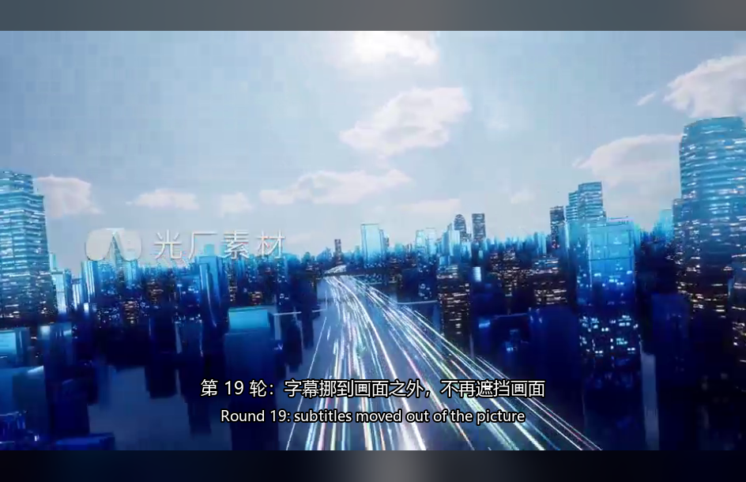
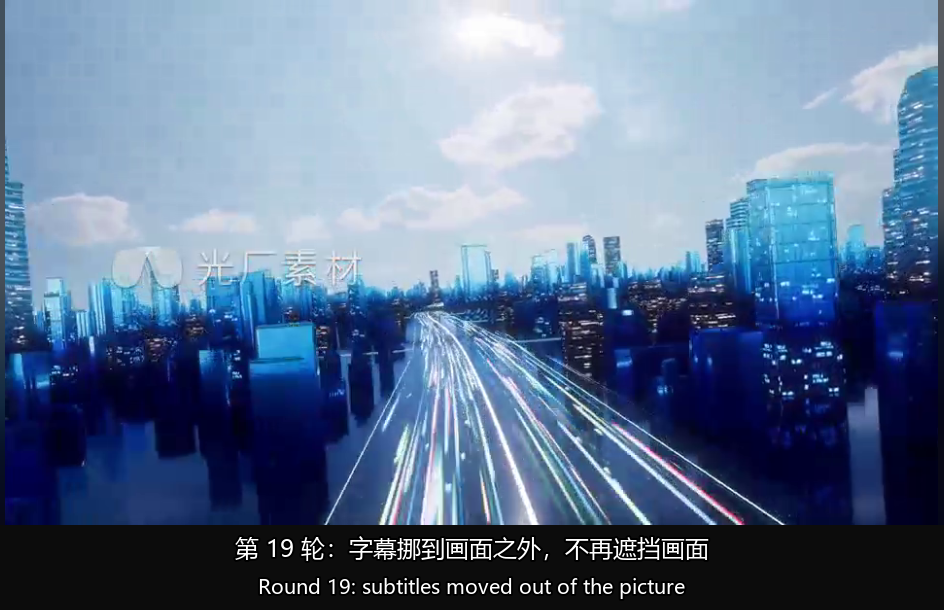

# 第 19 轮：独立字幕栏 —— 把字幕挪出画面

> 起因（用户在验收第 18 轮时提的设计质疑，原话）：
> 「字幕放在画面里面不就影响了 3d 画面的观感了吗？真的应该加字幕功能吗？
> 　还是说把字幕放在不影响画面的位置？」
>
> 用户选定方案：**独立字幕栏（可选开关）**。

 

> 左：默认（字幕画在画面内底部）。右：勾上【字幕栏】/ 按 B 之后。
> 两张都是**程序真正上屏的那一屏**（`app._screenshot_frame()` 复用
> `_last_display_image`），同一个窗口尺寸、同一句字幕，唯一变量就是字幕栏。
> 左图能看出字幕压在城市道路画面上；右图字幕落在那条纯色横条里，画面一个像素
> 也没被字盖住。

---

## 1. 先把那个质疑拆成两个问题

用户一句话里其实混了两件事，而且**一半是真问题、一半并不存在**。先分清楚，
不然会去修一个不存在的毛病。

| 担心 | 事实 | 结论 |
|---|---|---|
| 字幕在 3D 里会不会**深度错乱 / 重影**？ | 字幕画在 `_process_3d()` **之后**（`current_frame_image` 已经是 3D 编码完的产物），左右眼拿到同一份像素 ⇒ 落在**屏幕平面（零视差）** | **不存在。** 而且这个顺序反过来才是错的：画在编码之前，红蓝模式会把字拆成红/青重影，隔行/隔列/棋盘会把字按奇偶分给左右眼（被切纹、边缘发虚）。专业 3D 电影字幕也放零视差平面 |
| 字幕会不会**遮住画面**、破坏沉浸感？ | 会。画在画面内底部就必然压住画面下缘一条 | **真问题**。但要注意它跟 3D 无关 —— 2D 播放时一模一样，所有播放器都这么放。3D 只是让这件事更扎眼 |

所以真正要决定的只有一句：**愿不愿意接受画面底部一条被字盖住。** 不愿意，
就得换个摆法。三种摆法的取舍见第 2 节。

---

## 2. 为什么不做「放进黑边里」

这是最直觉的替代方案（看着"免费"：黑边本来就是空的），但它有个**前提条件**：

> 黑边只在"窗口宽高比 ≠ 视频宽高比"时才存在。

- 看 2.35:1 宽银幕电影 → 上下黑边很宽，放字幕绰绰有余；
- 全屏看 16:9 片子装在 16:9 显示器上 → 画面刚好铺满，`fg_w == win_w and
  fg_h == win_h`，黑边是 **0 像素**，字幕无处可放。

而且本轮实测撞上了一个更能说明问题的数字（见本文开头那两张图）：

| | 数值 |
|---|---|
| 中英两行字幕实际需要的高度 | **51 ~ 55 像素** |
| 左图（画面内版）底部那条黑边的高度 | **40 像素** |

**放不下。** 中英双语两行比一条黑边还高，所以"放进黑边"在窗口比例接近视频比例
时是行不通的 —— 它必须再写一套"放不下就退回画面内"的 fallback，而那套 fallback
恰恰就是它想避免的东西。

**独立字幕栏没有这个前提**：栏是从窗口底部主动**切**出来的，要多少切多少。
代价写死在明面上（画面小一点），换来"字幕与画面彻底互不干扰"。这正是用户选它的理由。

---

## 3. 实现：在渲染收尾"切一条"出来

改动集中在 `render_current_frame` —— 也就是第 18 轮选定的那个接缝（"整屏合成完、
还没上屏"的那一刻）。没有动任何 Tk 布局，理由还是那条：**所有让画面变化的路径
最后都汇集到这一个方法**，改一处就全覆盖。

```python
bar_h = self._subtitle_bar_height(win_h)     # 0 = 不启用（默认）
avail_h = win_h - bar_h                      # 画面只在上面那块里取景

fg_w, fg_h, interp = viewfit.fit_min(w, h, win_w, avail_h)   # ← 取景高度变了
...
y0 = (avail_h - fg_h) // 2                   # 在**可用区**里居中，不是整个窗口
canvas[y0:y0 + fg_h, x0:x0 + fg_w] = fg

if bar_h:
    canvas[win_h - bar_h:win_h, :, :] = SUBTITLE_BAR_COLOR_BGR   # 纯色横条
    subtitle_box = (0, win_h - bar_h, win_w, bar_h)              # 字幕落在栏里
    subtitle_placement = "bar"
else:
    subtitle_box = video_box                                     # 第 18 轮的老行为
    subtitle_placement = "overlay"
```

`_compose_subtitles(image, box, placement)` 因此多了个"落点"参数：
`overlay` 沿容器底边贴（老行为），`bar` 在容器里垂直居中。字号也跟着换基准 —
`overlay` 按**画面高**算（全屏时字跟着变大），`bar` 按**栏高**算（栏是固定高度的
一条）。两者都夹在各自的 min/max 之间。

字幕栏的底色是**纯色**（`SUBTITLE_BAR_COLOR_BGR = (12,12,12)`），刻意不用那层
模糊背景 —— 它必须让人一眼看出"这条在画面之外"，否则用户会以为字幕还是画在画面里。
（⚠️ 那个常量是 **BGR**：它写进还没 `cvtColor` 的 canvas。换颜色时通道顺序反着看。）

---

## 4. 五条准入条件：一条不满足就不切栏

```python
def _subtitle_bar_height(self, win_h):
    if not self.subtitle_bar:                        return 0
    if not self.subtitle_enabled or self.subtitle_mode == "off":  return 0
    if not self.subtitle_set.available:              return 0
    if not self.subtitle_font_path:                  return 0
    if win_h < SUBTITLE_BAR_MIN_WINDOW_H:            return 0
    return max(SUBTITLE_BAR_MIN,
               min(SUBTITLE_BAR_MAX, int(win_h * SUBTITLE_BAR_RATIO)))
```

每条的理由：

| 条件 | 为什么 |
|---|---|
| 开关没开 | 默认行为一个字都不许变（这是"可选"的全部含义） |
| 总开关关 / 模式=关闭 | 不画字幕要一条栏干什么 |
| 没有字幕集 | 切出来是条**空横条**，白让画面变小 |
| 找不到中文字体 | 反正一个字都画不出来（见 `subtitle.find_font`） |
| 窗口太矮（< 260px） | 切掉 14% 之后画面已经没法看了 —— 宁可不切 |

**最关键的一条设计：这里故意不看「当前这一秒有没有 cue」。**

字幕之间是有空档的（一句说完、下一句还没到）。如果按 cue 判断，栏会在播放中
一闪一闪、画面跟着一抽一抽 —— **那比遮挡难看得多**。所以栏高只取决于"这部片子
有没有字幕 / 开关 / 窗口高度"，播放过程中恒定。

由此带来一个诚实的副作用：**在"有字幕"和"没字幕"的两个文件之间切换时，画面会
跳一下**（栏出现或消失）。这是刻意的取舍 —— 另一条路是"永远留着栏"，代价是给
没有字幕的片子白搭一条空带。两害相权，选了前者。

---

## 5. 顺手修掉的一个真 bug：V 键在真机上是死的

这轮动快捷键时发现的，而且它是**第 18 轮埋的、被测试放过去的**：

```python
_ALL_SHORTCUT_KEYS = (... "v")        # 表里有 v
def _on_key_shortcut(...):            # 实现里也有 v
    ...
    elif key == "v": self.cycle_subtitle_mode()

# 但真正注册绑定的那一句是手写的：
for seq in ("<Left>", "<Right>", "<Up>", "<Down>",
            "<Key-m>", "<Key-f>", "<Key-j>", "<Key-k>", "<Key-l>"):
                                          # ↑ 没有 <Key-v>
```

**表里有、实现里有、绑定里没有** —— 于是真机上按 V 一点反应都没有，而
`tests/test_subtitles.py` 第 ⑧ 节**全绿**。原因只有一个：那一节是
`app._on_key_shortcut(_Key("V", widget=root))`，**直接调函数，绕过了 Tk 的派发链**。
它证明的是"这个函数会循环模式"，不是"按 V 会有反应"。

修法不是补一个 `<Key-v>` 了事（下次加键还会漏），而是**照表生成绑定**：

```python
_KEY_SEQUENCES = {"left": "<Left>", "right": "<Right>",
                  "up": "<Up>", "down": "<Down>"}
for _key in _ALL_SHORTCUT_KEYS:
    if _key == "space":
        continue                      # 空格单独绑，要跟按钮的类绑定配合
    self.root.bind_all(_KEY_SEQUENCES.get(_key, "<Key-%s>" % _key),
                       self._on_key_shortcut)
```

现在**"在表里"就等于"真的绑上了"**，想让某个键失联必须显式删掉它。
配套的回归判据是问 Tk 自己，不是问我们自己的表：

```python
unbound = [k for k in fp._ALL_SHORTCUT_KEYS if k != "space"
           and not root.bind_all(_SEQ.get(k, "<Key-%s>" % k))]
```

这条断言如果早写一天，第 18 轮那个 bug 根本活不过当天。

---

## 6. 本轮踩的坑

### 6.1 拍脑袋定的阈值当场假失败（这一次是好事）

验"关掉栏以后同一条带里装的是画面"时，第一版判据是"和栏色差得远的像素 > 50%
的带面积"。实测 **29%** —— 假失败。

原因不是代码错，而是**判据选错了**：它默认"画面比栏色亮"，而画面下缘（城市道路）
本来就偏暗，大量像素离 `(12,12,12)` 不到 40。这种判据在别的视频上会时灵时不灵。

按这个项目的规矩，**不能顺手把 50% 改成 25%**（那是把断言放宽到刚好变绿，
等于没有断言）。改成量准了再定：写了个一次性诊断脚本，把六种情形（开/关栏 ×
中/英/双语/无字幕）的观测量都打出来 ——

| 情形 | 带里最常见的颜色 | 占比 | 离中位色的"墨迹" |
|---|---|---|---|
| 开栏 + 中文 | **(12,12,12)** ← 就是那条栏色 | **95.3%** | 2.0% |
| 开栏 + 双语 | (12,12,12) | **90.0%** | 4.0% |
| 关栏 + 中文 | (4,4,14) ← 画面里的颜色 | **1.3%** | 35.4% |
| 关栏 + 无字幕 | (1,1,18) | 1.4% | 34.9% |

**68 倍的差距**，而且语义直接：「这条带 95% 是一个颜色」= 平色带；「最多的一种
颜色只占 1.3%」= 画面本来就不平。于是判据换成**最常见颜色的占比**，顺带把"最
常见的就是我们写进去的那条栏色"一并验了 —— 比原来那条更强，也不是放宽阈值。

被删掉的那版判据留在测试的 docstring 里，写明"为什么不用它"。

### 6.2 `cv2.imwrite` 写不了中文文件名

导出本文开头那两张图时，`cv2.imwrite("docs/...第19轮....png", img)` 直接报
`can't open file for writing: permission denied` —— **看着像权限问题，其实是编码**：
OpenCV 在 Windows 上用窄字符路径 `fopen`，中文文件名打不开。

改成 `cv2.imencode(".png", img)` 再用 Python 的 `open(path, "wb")` 自己写。
（读也是同理：`cv2.imread` 读不了中文路径，要用 `np.fromfile` + `cv2.imdecode`。
本轮量数字时就先踩了一次。）

### 6.3 栏里的字会溢出（极端情况）

窗口很矮、中英两行各自还折了行（最多 4 行）时，字体按栏高算出来的图层可能比栏
还高。做法是**缩小一档重画**，并刻意**不做裁剪** —— 裁剪会把字切掉半截，比
"压到画面底边一点点"更难看。这条分支有测试覆盖，但它真的只是兜底。

---

## 7. 测试分层（`tests/test_subtitles.py` 第 ⑩ 节，新增 21 项）

第 ⑩ 节紧跟在第 ⑧ 节（端到端像素证据）之后，两组都是**只查像素、不查变量**：

| 分组 | 查什么 | 关键数字 |
|---|---|---|
| **快捷键绑定加固** | （先）`_ALL_SHORTCUT_KEYS` 里每个键都真的绑到了 Tk；（再）发**真实按键**（`event_generate`，走完整派发链） | 漏绑：无；V/B 都是"真实按键派发"成功 |
| **栏高准入** | 五条条件各一条断言 + "同一部片子里栏高恒定" | 窗口 610 → 栏高 85；259 像素 → 0 |
| **像素证据** | ① 栏里有字 ② 栏里除了字就是纯色 ③ 最常见色 = 栏色且占比 > 85% ④ 开栏时中↔双语差异**全在栏内** ⑤ 关栏后同一条带里装的是画面 | 笔画 1588 / 栏面积 80240；最常见色 (12,12,12) 占 95.3%；**10094 / 10094 全在栏内**；关栏后占比 1.3% |
| **控件接线** | `subtitle_bar_check.invoke()`（等于用户点一下）→ 状态翻转；`_sync_subtitle_ui` 双向同步；状态行的三种说法 | 全部一致 |

④ 是这一节最硬的一条：**"画面区一个像素都没动"**。它证明的不是"多画了几个像素"，
而是"加的那行字**只**落在栏里"。

---

## 8. 本轮改了哪些文件

| 文件 | 变化 |
|---|---|
| `final_player.py` | 新增 `SUBTITLE_BAR_*` 七个常量；`_init_subtitle_state` 加 `subtitle_bar` / `subtitle_bar_var`；底栏加【字幕栏】勾选框；**`_bind_global_shortcuts` 改成照 `_ALL_SHORTCUT_KEYS` 生成绑定**（修 V 键 bug）；抽出 `_video_area_size()`；`render_current_frame` 切栏并走新落点；新增 `_subtitle_bar_height` / `on_subtitle_bar_toggle` / `toggle_subtitle_bar`；`_compose_subtitles` 加 `placement`；`_subtitle_status_text` / `_sync_subtitle_ui` / `_on_key_shortcut` / `show_shortcuts` 同步 |
| `tests/test_subtitles.py` | 新增第 ⑩ 节（21 项）；`_ALL_SHORTCUT_KEYS` 绑定存在性检查 |
| `docs/final_player_第19轮_独立字幕栏.md` | 本文 |
| `docs/final_player_第19轮_字幕在画面内.png` | 对照图（默认行为） |
| `docs/final_player_第19轮_独立字幕栏.png` | 对照图（新开关打开） |

**没有改**：`subtitle.py`（一个字都没动 —— 字幕栏只是换了 `image.paste` 的落点，
解析/认语种/渲染层全都没关系）、`run_tests.py`、`tests/_harness.py`。

### 实测数字

| 项目 | 结果 |
|---|---|
| `run_tests.py --full` | **15 组全绿，总耗时 369.2s**（语法 0.4 / 功能 61.7 / 定时器 21.1 / 快捷键 50.8 / 播放列表 18.3 / 记忆位置 11.4 / 双语字幕 6.3 / 音轨探测 15.9 / 转换补音轨 6.7 / 稳态速度 17.0 / 乱序压力 seed=1~5 共 159.7） |
| 字幕套件（第 18~19 轮） | **117 PASS / 0 FAIL** |
| 栏高（窗口 944×610） | **85** = `clamp(0.14 × 610, 48, 150)` |
| 画面内版：视频画面矩形 / 字幕笔画 | y 39..570 / **y 482..532**（字幕压在画面里，比画面底边高 38px） |
| 字幕栏版：视频画面 / 栏 / 字幕笔画 | y 0..525 / **y 525..610（85 行）** / **y 539..593**（完全落在栏内） |
| 中英两行的实际高度 vs 底部黑边 | **51~55px** vs **40px** ⇒ 放不进黑边（第 2 节的实证） |
| 栏带里最常见颜色的占比 | 开栏 **95.3%**（就是栏色）/ 关栏 **1.3%** |
| 开栏时切模式的差异像素 | **10094 / 10094 全在栏内**（画面区 0 个） |
| 栏里的笔画像素 | 1588 / 栏面积 80240（2.0%） |
| 快捷键绑定 | `_ALL_SHORTCUT_KEYS` 11 个键（space 除外）**全部真的绑上了 Tk** |

---

## 9. 留给后来人

- **想改栏高**：只动 `SUBTITLE_BAR_RATIO` / `MIN` / `MAX` / `MIN_WINDOW_H`
  四个常量。别在 `render_current_frame` 里另算一套 —— 状态行也调用
  `_subtitle_bar_height()`，两处不一致的表现是**状态行说有栏、画面上却没有**。
- **`SUBTITLE_BAR_COLOR_BGR` 是 BGR**（写进未 `cvtColor` 的 canvas）。想要深蓝
  得填 `(60, 20, 10)` 这种，不是 `(10, 20, 60)`。
- **别把"当前有没有 cue"加进 `_subtitle_bar_height`**：栏会开始闪，画面会一抽一抽。
  想按 cue 判断就必须先解决那个抖动（例如给栏加"宽限期"），别直接改条件。
- **`_video_area_size()` 是唯一取窗口尺寸的地方**（渲染和状态行共用）。
  要加新的"依赖窗口尺寸的显示决定"，从这儿拿，别再抄一份 winfo 链条。
- **加字幕相关的新快捷键**：只往 `_ALL_SHORTCUT_KEYS` 里加 keysym + 在
  `_on_key_shortcut` 里加一个分支。**绑定是自动生成的**，别再去手写序列列表
  —— 第 18 轮那个 bug 就是这么来的。
- **`subtitle_bar` 目前不落盘**（和 3D 模式 / 倍速 / 音量一样，都是会话内的）。
  要持久化的话，`playlist_store.py` 那套原子写可以直接照搬，但先想清楚：
  这是"我怎么看片"的偏好，还是"这个文件"的属性 —— 本项目的先例是前者不落盘。
