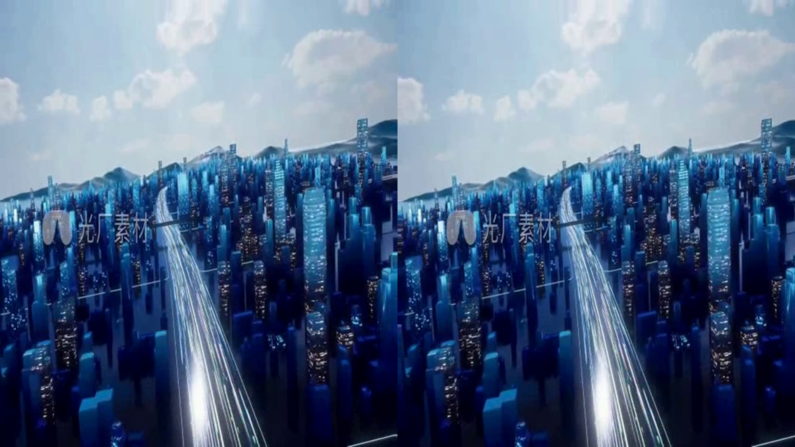
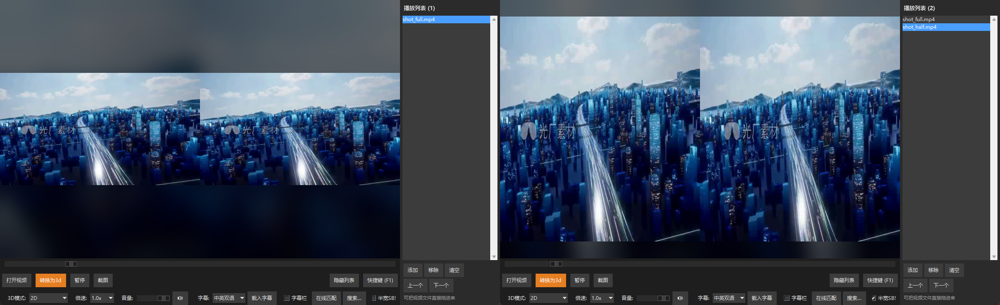

# 第 25 轮 · 半宽 SBS：让转换产物全屏时铺满

## 起因

用户原话：

> 现在需要追加一份修改，我需要生成的两份视频画面完美填充画面，怎么修改？

追问「完美填充」是哪种效果时，用户给了一段**参考视频**（微信收到的一个 mp4，
3 分 32 秒，960×544），说：

> 全屏时像这个视频里的效果这样，一边填充半个屏幕，使得视频画面完美填充

——「一边填充半个屏幕」是这句话的重心。

## 本轮最值钱的判断：参考视频和你的产物**不是同一个格式**

先做了两件事：把参考视频抽帧量规格，以及算清楚现有产物的几何。

| | 参考视频 | 转换产物（本轮之前） |
|---|---|---|
| 整幅尺寸 | 960×544（**16:9**） | 2560×720（**32:9**） |
| 每一半 | 480×544 —— **横向压了一半** | 1280×720 —— 原样 |
| 格式名 | **半宽 SBS**（half-SBS） | **全宽 SBS**（full-SBS） |
| 全屏表现 | 天然铺满，左右各占一半 | 只占中间一条，上下大片留空 |

**它能「一边填满半个屏幕」不是播放器做了什么，而是它整幅就是 16:9** ——
放进 16:9 屏幕天然铺满，一个像素都不用处理。而 32:9 的产物塞进 16:9 屏幕，
数学上只有三条路：

1. **裁边**：放大到铺满，左右各切掉 25%（每半只剩中间一半宽）
2. **压扁**：横向压成一半，内容全留但画面变瘦
3. **改产物**：让它本身就是 16:9

用户选了第 3 条。这也是**标准**做法 —— half-SBS 是 3D 电视「并排」模式、
VR 盒子、YouTube 3D 都认的格式，而且文件小一半。

### 做完之后长这样

全屏（16:9）下的半宽产物 —— 左右两份各占半个屏幕，**100% 铺满、零黑边**：



同一个窗口、同一份内容，两种产物的对比（左：全宽 32:9，只占中间一条；
右：半宽 16:9，上下已基本铺满）：



> 顺带解释了一个现象：参考视频里那两份画面看着偏瘦，就是因为每半被横向压过。
> 拿它配眼镜看 3D，是要把每半再拉宽 2 倍还原的。

## 做法：**一个开关管两头**

`half_sbs` 一个键，同时决定：

- **转换输出**：每半横向压一半再并排 → 产物整幅宽度 = 源宽度 = 16:9
- **播放合成**：3D 合成前把每半拉回 2 倍 → 画面比例正常

**为什么不做成两个开关**：这两件事本来就是同一个格式约定的两端。拆开之后，
用户迟早会把它们调成互相矛盾的组合（转出半宽、却按全宽播），然后画面是扁的 ——
而且那种"扁"很难被归因。一个开关，语义就是「我用半宽 SBS 这套格式」。

默认**开**（用户的诉求就是它），状态存在用户配置目录，下次启动还是这个选择。
按 `H` 键或底栏勾选框都能切。

## 改动清单

| 文件 | 改了什么 |
|---|---|
| `settings_store.py` | **新增**。标量偏好的落盘（白名单键 + 坏数据降级 + 原子写） |
| `depth3d.py` | `process_3d()` 加 `source_half` 参数：合成前把每半拉回 2 倍 |
| `final_player.py` | 设置状态、勾选框、`H` 键、转换输出宽度、F1 说明、`_process_3d` 传参 |
| `tests/test_half_sbs.py` | **新增**。7 节 35 项 |
| `tests/_harness.py` | `load_app(half_sbs=)` + `make_settings_path()` 隔离 |
| `run_tests.py` | 注册第 13 个具名套件；`settings_store.py` 纳入语法检查 |
| `.gitignore` | 兜底忽略根目录的 `settings.json` |

### 为什么单开一个 `settings_store` 而不是塞进已有的两个 store

`playlist_store` / `resume_store` 都是**列表型**数据（键是路径、值是记录），
schema 很窄。而这里的值是**标量偏好**，形状不同：硬塞要么污染它们的结构，
要么把 JSON 改成两用（读的时候还得猜是哪一种）。

它的关键设计是**白名单**：`load()` 只回 `DEFAULTS` 里声明过的键，每个键都有
默认值。于是文件不存在 / 坏 JSON / 不是字典 / 手改出多余键，全都退化成
「用默认值」—— 既不会让播放器起不来，也不会让脏数据渗进程序状态。

一个细节：类型检查用 `type(value) is type(default)` 而**不是** `isinstance` ——
`bool` 是 `int` 的子类，用 `isinstance` 会把手改出来的 `"half_sbs": 1` 当成合法
布尔值收下。

## 几何与实现上的六个决定

### 1. 拉伸必须在 `swap_eyes` 和视差**之前**

`swap_eyes` 和视差都是按「一只眼的完整画面」定义的。先拉回来，它们才在同一个
尺度上工作；顺序反了，视差量会被压缩 2 倍（看着"视差不起作用"）。

### 2. 视差网格要用**拉伸后**的宽度

```python
x_base, y_base = mesh.get(h, left_eye.shape[1])   # 原来是写死的 w_half
```

写死 `w_half` 时，半宽下网格是 640 宽而画面是 1280 宽 —— `cv2.remap` 直接抛错。
`MeshCache` 本来就按 `(h, w)` 做键，两种宽度各自缓存一份，不会互相踩。

### 3. 2D 模式**不动**

`process_3d` 在 2D 模式下第一句就 `return frame`，所以半宽 SBS 的并排显示
就是「两份压扁的画面铺满整屏」—— 正是参考视频那个样子，正是它该有的样子。

### 4. 半宽产物宽度必须是偶数

```python
eye_w = max(2, width // 2)      # 每半宽度
out_w = eye_w * 2               # 产物宽度 = 每半 × 2
```

`out_w` 用 `eye_w * 2` 而不是直接用 `width` —— 源宽度是奇数时 `width // 2 * 2`
会比 `width` 少 1，`VideoWriter` 收到的尺寸和实际写入的帧就对不上，**写不进去**。

### 5. 转换中途不能改这个开关

输出尺寸一旦开始写就不能变。所以 `process_video_to_3d` 在**开头**把它快照进
局部变量，后面一律用那个快照 —— 转换中拨勾选框只影响下一次转换。改这个选项
也没关系，不会让 `VideoWriter` 一会儿宽一会儿窄。

### 6. 放大用 `INTER_LINEAR`、缩小用 `INTER_AREA`

跟 `viewfit.fit_min` 的判断保持一致（放大时 `INTER_CUBIC` 更好但更慢，而这是
每帧两次的全画幅操作，走线性足够）。

## 两个**如实交代**的代价

1. **每眼的像素数只有全宽的一半**（产物宽度减半 → 每半 640 宽而不是 1280）。
   拿给 VR 头显看时能看出来；配红蓝眼镜看影响很小（红蓝本来就把两幅叠在一起，
   有效分辨率受限）。**想换回来：关掉勾选框重新转一次即可**，两个方向都能转。
2. **看别人给的全宽 3D 片时要记得把勾去掉**，否则画面会被横向拉长。

第 2 条**没法自动识别**，这是格式本身的性质：half-SBS 的整幅就是 16:9，和
普通视频的比例一模一样，光看画面尺寸判断不出来。要做自动识别只能上"内容先验"
（比如人脸宽高比），太脆，不值得。所以它就是一个**手动开关** —— 但用户自己的
工作流（转 → 看）永远是自洽的，因为默认值就跟着转换走。

## 测试（`tests/test_half_sbs.py`，7 节 35 项）

| 节 | 覆盖 |
|---|---|
| ① | `settings_store`：往返、坏 JSON、类型错、非字典、白名单落盘 |
| ② | 几何：半宽源合成尺寸 == 全宽源；对照「忘了拉伸」只有半幅宽 |
| ③ | 内容：两条路径**逐像素**比（均差 0.62）+ 交叉验证（逐像素相同） |
| ④ | 边上行为：2D 不受影响、交换左右眼、四种 3D 模式、视差 |
| ⑤ | **真跑一次转换**（半宽 / 全宽各一次），量产物宽度 |
| ⑥ | 接线：勾选框 `invoke()`、`H` 键**真实 Tk 派发**、绑定真的存在 |
| ⑦ | 重绘：改完设置后**画面本身**从 1920 宽变成 3840 宽 |

③ 和 ⑦ 是这套的骨头，两条都**不查变量**：

- ③ 证明「真的拉对了」—— 尺寸对不等于内容对。最硬的一条是**交叉验证**：
  `source_half=True` 的结果，与「手工把源恢复成正常比例、再走普通路径」必须
  **逐像素完全相同**。
- ⑦ 证明「真的重画了」—— 变量对了而画面上没变，是完全可能发生的事。

⑤ 是本套件唯一"慢"的一节（要加载深度模型、真跑两次转换），但它是唯一能钉住
**产物宽度**这个需求本身的地方 —— 前面几节全绿而转换仍然输出 32:9 是可能的。

### 一个被套件自己抓出来的错误判据

反例那一版写的是「先合成再整体拉伸 = 错误做法」，结果**这条反例本身就是对的**：

> 对红蓝模式而言，「先拉伸每半再合成」和「先合成再整体拉伸」在数学上**等价**
> —— 合成是逐像素的通道操作（`cv2.split` / `cv2.merge`，不跨像素），而
> `cv2.resize` 对每个通道独立。

所以它根本当不了反例。记在这里是因为它同时也是**实现上的自由**：将来若有人
为了省两次 resize 而改成"先合成后拉伸"，**对红蓝模式是安全的**（但隔行/隔列/
棋盘那几种就未必 —— 它们的合成是跨像素的取样，不能这么换）。

## 诚实数字

```
新增/改动   settings_store.py（新，约 100 行）
            depth3d.py        +20 行左右（拉伸 + 网格宽度）
            final_player.py   5 处
            tests/test_half_sbs.py（新，约 320 行）
            tests/_harness.py +30 行（含 make_settings_path）
回归        18 组（13 具名 + 5 乱序）全部通过，0 FAIL，472.8s（新套件自身 72.2s）
套件自身    35 PASS / 0 FAIL
产物宽度    源 1920×540 → 半宽产物 1920×540；全宽产物 3840×540
```

## 留给后来人

- **半宽 SBS 的"拉回 2 倍"必须在 `depth3d.process_3d` 里做**，不要在调用点各写
  一遍 —— 三个调用点（`update_frame` / `change_display_mode` / `_refresh_paused_frame`）
  各写一遍，迟早漏一个，而漏掉的表现是"某些情况下画面突然变扁"。
- **`settings_store.DEFAULTS` 是唯一的事实来源**。加新设置先在那里登记，否则
  `load()` 永远读不出来（它只认白名单）。默认值也写在那儿。
- **`_harness.load_app` 的默认值一律是"老行为"**（`autoplay_next` / `resume_enabled`
  / `subtitles` / `half_sbs` 四个都是 `False`）—— 这是刻意的：新功能不该悄悄
  改变老套件量的东西。新功能自己的套件显式打开它。
- 本轮的开关**只影响显示与转换，不影响播放/音频/字幕**，所以音频那一堆历史
  包袱没有跟着动 —— 这也是把它做成"格式约定"而不是"渲染模式"的好处。
